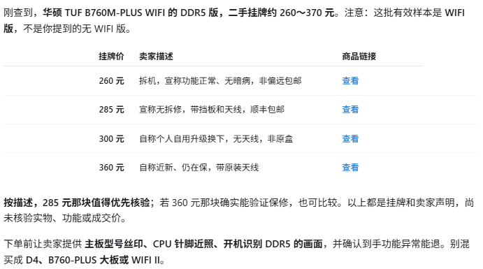

<p align="center"></p>

# pick-skills · 捡垃圾-skills

**作者：lavineleo · 版本：1.2.0 · MIT License**

通过本机 Chrome 搜索闲鱼，按关键词、价格、地区和标题筛选商品，用 SQLite 保存任务和商品记录并去重。支持 Windows 命令行操作，使用约定见 `SKILL.md`。

## 使用效果

查询商品后，汇总挂牌价格、卖家描述及商品链接，便于对比筛选。



*用户提供的实际查询示例。价格为查询时的挂牌信息，商品状态与价格可能变化。*

## 安装

需要 Windows 10/11、PowerShell 5.1+、**Node.js 24.12+**、**Google Chrome**。不需要 Python、ChromeDriver 或 Selenium，也不需要单独安装 SQLite。Puppeteer Core 通过 CDP 连接本机 Chrome。

1. 下载本项目 ZIP 并解压，或克隆仓库。
2. 在解压后的 `pick-skills` 文件夹中打开 PowerShell。
3. 运行安装引导：

```powershell
powershell -NoProfile -ExecutionPolicy Bypass -File .\scripts\setup-Windows安装-v1.ps1
```

缺少 Node.js/Chrome 时，脚本会显示官方下载地址。也可以使用下面的选项通过 winget 安装缺少的程序（可能出现系统安装提示）：

```powershell
powershell -NoProfile -ExecutionPolicy Bypass -File .\scripts\setup-Windows安装-v1.ps1 -InstallPrerequisites
```

脚本使用 `npm ci` 安装锁文件中的依赖，再运行环境检查；不自动创建监控任务。已有 Node.js 和 Chrome 的用户也可以直接执行：

```powershell
npm.cmd ci
npm.cmd run doctor
```

详细说明，包括 SOCKS5/HTTP 代理与故障排查：[Windows 安装指南](docs/INSTALL-WINDOWS.md)。

## 开始使用

```powershell
npm.cmd run browser:start
```

在专用 Chrome 中手动登录闲鱼并处理网站验证。登录资料保存在 `data/chrome-profile`。关闭此窗口即可停止该浏览器。

按你的真实需求添加任务（以下仅为命令写法，不是内置测试数据）：

```powershell
node scripts/xianyu.js add --keyword "你要找的商品" --min-price 100 --max-price 500 --filter "故障,维修"
node scripts/xianyu.js list
node scripts/xianyu.js scan --hours 24
node scripts/xianyu.js history --limit 20
```

| 操作 | 命令或选项 |
|---|---|
| 帮助 | `node scripts/xianyu.js --help` |
| 只扫描某个任务 | `node scripts/xianyu.js scan --id 1` |
| 停用任务，保留历史 | `node scripts/xianyu.js remove --id 1` |
| 地区筛选 | 添加任务时使用 `--region "深圳,广州"` |
| 标题必含词，满足任一 | 添加任务时使用 `--only "国行,在保"` |
| 浏览器状态 | `npm.cmd run browser:status` |
| 环境诊断 | `npm.cmd run doctor` |

扫描输出是商品挂牌信息，不是成交价格，也不代表对商品真实性或成色的核验。定时运行、消息通知需另行配置，本项目不会自动发送消息或下单。

## 配置

在运行命令的同一 PowerShell 窗口中设置；无需修改源码：

```powershell
$env:XIANYU_CHROME_PATH = 'C:\Program Files\Google\Chrome\Application\chrome.exe'
$env:XIANYU_CDP_PORT = '18803'
$env:XIANYU_DB_PATH = Join-Path $PWD 'data\xianyu-monitor.db'
```

默认端口为 18803；数据库和浏览器资料位于项目 `data/`。为兼容旧数据，仍保留 `XIANYU_*` 变量和 `xianyu-monitor.db` 文件名。旧项目的数据可通过 `XIANYU_DB_PATH` 指向，避免误认为任务丢失。

## 项目结构

```text
pick-skills/
├── SKILL.md                    # 使用约定
├── scripts/                    # 安装、环境诊断、浏览器与监控入口
├── infra/                      # 浏览器平台支持
├── assets/                     # 项目 Logo
├── docs/                       # 安装和发布说明
├── .github/workflows/          # Windows 静态与空任务检查
├── package.json
└── package-lock.json
```

`data/`、`node_modules/`、`releases/` 在本地运行后产生，不属于源码发布内容。不要上传浏览器资料、Cookie、数据库或含认证信息的代理配置。

## 检查与打包

```powershell
npm.cmd run check
powershell -NoProfile -ExecutionPolicy Bypass -File .\scripts\package-GitHub打包-v1.ps1
```

打包后可在 releases/ 目录获取源码 ZIP 和 SHA256 校验文件。

## 使用说明

支持 Windows 10/11。搜索需要网络连接和有效的闲鱼登录状态；网站要求验证时，请在浏览器中完成后重试。商品结果会按本地历史去重。

安装问题请查看 [Windows 安装指南](docs/INSTALL-WINDOWS.md)，版本变更见 [CHANGELOG](CHANGELOG.md)。
